<div class="portada">

<p class="p-titulo"><b>Otear: prototipo de mediana fidelidad</b></p>
<p class="p-subtitulo"><b>Semana 2: verificar el cobro de una labor contratada por hectárea</b></p>
<p>Luis Manuel Rojas Correa</p>
<p>Código A00399289</p>
<p>Universidad Icesi</p>
<p>Prototipado (2026-2) MCUX</p>
<p>Nicolás Salom</p>
<p>1 de noviembre de 2026</p>
</div>

<p class="titulo-repetido"><b>Otear: prototipo de mediana fidelidad</b></p>

Otear reúne en un solo lugar las fotos, los mapas y los vuelos de dron de una finca. Hernando, de 56 años, administra la Hacienda Santa Rita (caña de azúcar, Valle del Cauca), trabaja en el computador de la oficina y usa WhatsApp. Contrata fumigaciones y otras labores que le cobran por hectárea y no tiene cómo comprobar cuántas hectáreas se hicieron de verdad. Ese es el punto de dolor PP3 de mi Semana 1 (S1; Rojas Correa, 2026): paga lo que no puede comprobar y queda mal ante sus socios si algo falla.

**El flujo que prototipé.** Es la tarea T2 de S1: «El operador le cobró 18,4 ha de fumigación. Revise si las hizo y, si no, mándele la evidencia». En S1 hice los wireframes de baja fidelidad (cajas, textos de ejemplo y marcadores); esta semana los convierto en un prototipo de fidelidad media, que responde y usa datos creíbles. Son tres pantallas: Labores y tareas (10), Verificar cobro (11) y Compartir evidencia (12). Lo elegí porque es donde Hernando decide si paga, y aceptar un cobro no se puede deshacer. Además depende de algo que todavía no sé si es posible: que el operador entregue un mapa de aplicación que se pueda leer (Tabla 3 de S1, fila 4). Los otros dos flujos de S1, subir un vuelo y pasar de un hallazgo a una tarea, tienen patrones conocidos o dependen de cosas que aún no decido, como qué hacer con las fotos sin GPS.

**Siglas de S1 que aparecen en este documento.** Las tablas de S1 se citan siempre con «de S1», para no confundirlas con las de este documento. PP1 a PP4: puntos de dolor. OB1 a OB3: objetivos de negocio. OD1: que Hernando sienta que sabe lo que pasa y lo que paga. T2: la tarea de la prueba que acabo de citar. Tabla 3 de S1: la matriz de supuestos de S1 (fila 2: verificar el cobro; fila 3: usabilidad con una persona de 56 años; fila 4: mapa del operador y GPS). Tabla 10 de S1: elementos de cada flujo. Tabla 11 de S1: cargas y errores por pantalla.

**Límites que conviene saber antes de leer.**

- Los datos son de ejemplo (Hacienda Santa Rita, sus lotes y cifras de S1), no de un cliente.
- No hice pruebas con personas en esta semana: las dos hipótesis se miden en la semana 4.
- El prototipo es de escritorio, de 1024 px en adelante. Todo se midió en un viewport de 1280 × 800 (el área del documento, no la ventana del navegador). A 375 px no se usa.
- Cada paso espera 0,9 s a propósito para poder ver el estado «Cargando». Ese tiempo se descuenta cuando mida tiempos.
- No hice prueba piloto, que recomienda Pernice (s. f.) antes de las sesiones con participantes para que los errores del prototipo no alteren lo que se mide. La haré en la semana 4.
- Un recorrido solo con teclado, de la lista al envío de la evidencia, lo hice yo el 1 de noviembre; con lector de pantalla no lo probé.

**Uso de IA.** La skill, el prototipo y la lógica los escribió Claude Code a partir de mis decisiones de flujo, alcance y criterios. Una segunda sesión de Claude, que no veía mi conversación, revisó la entrega contra la rúbrica. Lo que corrijo en la sección 5 salió de revisar yo lo generado y de ese informe.

# 1. Hipótesis a validar

Pongo a prueba dos hipótesis de S1: una de comprensión (¿entiende lo que le cobran?) y una de decisión (¿reclama en vez de pagar?).

**H1 · Comprensión** (OD1 y PP3; el criterio de «cuatro de cinco sin ayuda» es el de la fila 3 de la Tabla 3 de S1)

> Creo que **Hernando** logrará **decir sin ayuda si lo cobrado coincide con lo aplicado** en la **pantalla 11 «Verificar cobro»** porque ve lado a lado lo cobrado, lo aplicado según el mapa del operador y el área de los lotes, con la diferencia en hectáreas y en pesos antes de cualquier botón. **Lo sabré si** al menos **4 de 5** participantes dicen, sin ayuda del moderador, que el operador cobró **1,3 ha ($117.000) más de las que muestra su propio mapa**.

También voy a registrar, sin que decidan la hipótesis: cuánto tardan desde que abren «Labores y tareas» (propongo menos de 2 minutos; S1 no fijó un tiempo para esta tarea, los 3 minutos de OB2 son para subir un vuelo) y la respuesta a «¿qué tanta seguridad tiene de saber lo que paga?» (de 1 a 5; busco un promedio de 4,5 o más, como pide OD1).

**H2 · Decisión** (Tabla 3 de S1, fila 2, y PP3)

> Creo que **Hernando** logrará **decidir enviar la evidencia al operador en vez de aceptar el cobro** en la **pantalla 11 «Verificar cobro»** porque, cuando la diferencia supera la tolerancia, el botón principal pasa a ser «Enviar evidencia al operador» y el mensaje de la pantalla 12 sale escrito con las cifras de la comparación. **Lo sabré si** al menos **4 de 5** participantes, al preguntarles «¿qué haría ahora?» con el veredicto a la vista y antes de pulsar nada, dicen que le mandarían la evidencia al operador y no que aceptarían el cobro.

Además, la fila 2 de S1 pide que al menos 3 de los 5 entrevistados hayan tenido una diferencia de cobro en el último año; lo preguntaré aparte.

**Cómo lo mediré.** Prueba moderada con 5 personas del perfil, con la tarea T2 y pensando en voz alta. Tengo previsto registrar éxito y tiempo en Maze si acepta un enlace externo; si no, con cronómetro y notas. Una persona «sin ayuda» es la que no recibe ninguna pista del moderador. Antes de las cinco sesiones haré una prueba piloto con una persona fuera de la muestra. Si alguien pulsa algo que no responde (por ejemplo, una de las seis secciones deshabilitadas del menú), el moderador no lo guía: le dice que eso no funciona en el prototipo y le pregunta qué esperaba, como recomienda Pernice (s. f.), y lo anota como hallazgo.

**Cómo leer los resultados.** Con 5 personas la prueba es formativa: sirve para encontrar y corregir problemas, no para estimar una tasa. Con el método de Wald ajustado, 4 de 5 equivale a un intervalo de confianza del 95 % entre 36 % y 98 %, y 5 de 5 entre 51 % y 100 % (MeasuringU, s. f.). Por eso «4 de 5» es mi regla para decidir si rediseño, no una cifra de éxito.

**Un sesgo que ya veo.** El botón principal del prototipo cambia según el veredicto, y eso empuja a H2. Por eso la pregunta de H2 se hace antes de que pulsen y se complementa con lo que cuenten de su finca real.

# 2. Matriz de fidelidad

Elegí cada nivel por lo que la prueba de la semana 4 necesita saber. Las cinco dimensiones son independientes (McCurdy et al., 2006): un prototipo puede ser bajo en una y alto en otra. Pernice (s. f.) lo plantea igual: la fidelidad puede variar por separado en interactividad, aspecto visual y contenido. Este es de fidelidad mixta. La Tabla 1 resume cada dimensión.

| Dimensión | Nivel y qué se ve | Por qué ese nivel, y qué no podré concluir |
|---|---|---|
| **Refinamiento visual** | **Bajo.** Escala de grises (en todos los elementos R = G = B, medido con estilos calculados), sin marca ni logotipo, Arial, bordes en vez de sombras. Mapas y fotos son marcadores con una X y su proporción real (16:9 y 4:3). Los estados se distinguen por forma (borde sólido, doble o discontinuo) y por texto. | H1 pregunta si Hernando entiende el veredicto por lo que dice. Sin rojo y verde, «Facturó de más» no se entiende por un semáforo: si lo entiende, es por el texto y los números. La marca y el color aún no están decididos. **No podré concluir** si el diseño final le da la confianza que busca OD1; eso se mide con una versión de alta fidelidad. |
| **Amplitud** | **Un flujo** de los tres de S1: verificar el cobro (pantallas 10, 11 y 12 y el estado «En reclamo»). Las otras seis secciones del menú están deshabilitadas. | Es el flujo de mayor riesgo (PP3, fila 2 de la Tabla 3 de S1). Subir un vuelo ya tiene un patrón conocido y depende de la política de fotos sin GPS, que sigue sin resolverse; del hallazgo a la tarea depende de una IA que aún no valido. Ampliar costaría días y no respondería a H1 ni a H2. **No podré concluir** cómo se siente moverse entre secciones. |
| **Profundidad** | **Alta en ese flujo.** Camino completo con tres salidas (enviar evidencia, aceptar, pedir el mapa al operador), errores con salida (mapa en formato no admitido, sin zonas, de otra finca o demasiado grande; vuelo que no cubre los lotes; mensaje no entregado) y una confirmación antes de aceptar el cobro, que no se puede deshacer. | H2 solo se prueba si existe el momento de decidir entre aceptar y reclamar. La fila 4 de la Tabla 3 de S1 (que el operador entregue un mapa legible) solo se prueba si el mapa puede fallar. Un flujo a medias habría dejado fuera lo que quiero observar. **No podré concluir** qué pasa después de enviar la evidencia: la respuesta del operador no está. |
| **Interactividad** | **Media-alta.** Responden los elementos de la tarea: cargar un archivo o usar el de ejemplo, elegir vuelo, comparar, editar el mensaje, marcar soportes, confirmar. Cada elemento clave tiene Normal, Cargando, Error y Deshabilitado en la misma pantalla. Transiciones instantáneas. | Medir éxito y tiempo exige que el sistema responda como uno real; con imágenes estáticas el participante tendría que adivinar. Quito la animación porque esta semana valido orientación, no movimiento. **No podré concluir** si el movimiento ayudaría a entender un cambio de estado. |
| **Modelo de datos** | **Alto en forma, de ejemplo en origen.** Las cifras de S1 cuadran entre pantallas (18,4 ha cobradas, 17,1 ha aplicadas, 20,8 ha de los lotes, 1,3 ha = $117.000 a $90.000 por ha). El mapa del operador es un KML que el navegador lee de verdad, con la misma aritmética de hectáreas de la demo anterior y 16 pruebas automáticas. Hay seis casos extremos cargables. | Pernice (s. f.) distingue contenido de fidelidad alta (el contenido final completo) de contenido de fidelidad baja (resúmenes o marcadores). Aquí es alto: los participantes tienen que reaccionar a dinero y hectáreas creíbles; con «$XX.XXX» no habría reacción que medir. Un archivo real que puede fallar prueba la factibilidad de leer mapas de operadores (fila 4). **No podré concluir** que sirva con los formatos de mapa que traigan operadores reales: eso necesita los tres operadores y los tres vuelos de la fila 4. |

Table: Fidelidad del prototipo en las cinco dimensiones

# 3. Skill, herramienta y captura de carga

**Herramienta.** Código (Next.js) con Claude Code, no Lovable ni Figma Make. El riesgo de este flujo está en una cuenta (hectáreas cobradas frente a aplicadas), en leer un KML real y en estados con espera, y un generador de pantallas no da esa lógica ni sus pruebas.

**La skill.** Está en `.claude/skills/otear-prototipo-s2/SKILL.md`. Tiene los siete bloques de la consigna (producto y usuario, hipótesis y riesgos, flujos y arquitectura, reglas de la etapa, reglas de contenido, reglas de comportamiento, prohibiciones). Cada regla dice qué hallazgo de S1 la respalda y cómo se comprueba en el navegador. El anexo completo está a continuación de este bloque (Tablas 2 a 8).

La Figura 1 muestra el archivo de la skill abierto en el proyecto.

<div class="par">
<figure>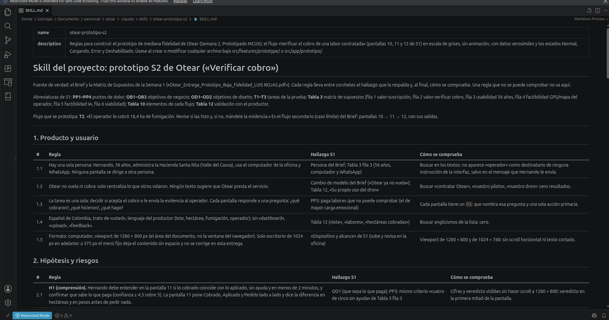<figcaption>El archivo de la skill abierto en el proyecto, con su encabezado (nombre y descripción) leído sin errores</figcaption></figure>
</div>

El archivo `SKILL.md` también va **adjunto a este PDF** (en el panel de adjuntos del visor), tal como está en el repositorio.

<!--SKILL_ANNEX-->

# 4. Prompt log

Usé dos iteraciones. La primera construyó el flujo completo; la segunda corrigió defectos que encontró una revisión externa. Sigo el formato de «Prompt por pantalla» del Figma de la clase: un bloque por pantalla, que parte de «Aplica [el sistema] a la pantalla X» y fija cada componente con valores exactos, y para los ajustes el «Prompt ajuste» («Ajusta solo este caso sin cambiar el resto: [caso]. Aplica [ajuste]. Regla: nada puede desbordar ni quedar cortado»). En ese Figma no encontré ninguna plantilla rotulada «B»; si el docente se refiere a otra, la paso a ese formato. Cada prompt cubre las tres capas de la consigna: **pantalla** (qué se ve), **comportamiento** (qué pasa al actuar) y **contenido** (qué dice, con datos reales).

## Iteración 1 · Construir el flujo

**Lo que escribí de verdad** (después de analizar la consigna y de elegir el flujo B): «Flujo B, empieza con la skill y la ruta del prototipo». Es corto a propósito: la especificación completa ya estaba en la skill y en el Brief de S1, y la herramienta la leyó antes de escribir código. Los tres bloques de abajo no son un mensaje que haya enviado así: son esa especificación, ordenada en el formato «Prompt por pantalla» para que se vea qué le exigía a la herramienta en cada pantalla, con la regla de la skill entre corchetes.

**Prompt por pantalla · Pantalla 10, Labores y tareas**

```
Aplica la skill otear-prototipo-s2 a la pantalla 10 (entrada del flujo; ruta /prototipo/verificar-cobro/, 1280 × 800).

PANTALLA
- Menú lateral fijo con las 7 secciones de S1; solo «Labores y tareas» habilitada, las otras seis con aria-disabled [3.3].
- h1 «Labores y tareas»; debajo, una tabla de labores (operador, lotes, hectáreas cobradas, estado).
- Arial 16 px en el cuerpo, ninguna etiqueta bajo 12 px, botones de 44 px de alto como mínimo [4.2, 4.7].
- Solo grises: texto #111, secundario #595959, bordes #767676, fondos #F2F2F2; sin marca ni color [4.1].
- Sin transiciones ni animación [4.3].

COMPORTAMIENTO
- Cada fila con diferencia por verificar tiene el botón «Verificar cobro»; tras enviar la evidencia pasa a «Ver reclamo» [6.9].
- Foco visible: trazo negro de 3 px; orden de Tab lógico [4.8].

CONTENIDO
- Hacienda Santa Rita; Agrodron del Valle fumigó los lotes 5 y 6 el vie 16 oct 2026 a $90.000 por ha; cobró 18,4 ha ($1.656.000) [5.2].
- Coma decimal, punto de miles, fechas «vie 16 oct 2026» [5.3].
- Más filas de otros operadores y labores, todas con texto real [5.1].
```

**Prompt por pantalla · Pantalla 11, Verificar cobro**

```
Aplica la skill otear-prototipo-s2 a la pantalla 11 (segunda pantalla del flujo). Mismos tokens de grises, Arial y 44 px.

PANTALLA
- h1 «Verificar cobro». Tres columnas lado a lado: Cobrado, Aplicado (según el mapa del operador) y Pedido (lotes medidos) [2.1].
- Columna del mapa: marcador con X, proporción 16:9, y «Usar el mapa de ejemplo» [4.4].
- Veredicto antes de cualquier botón; la nota del operador va debajo de las acciones, plegada [5.7].

COMPORTAMIENTO
- «Comparar» deshabilitado hasta tener mapa leído y vuelo propio elegido, con el motivo escrito [6.2].
- Elegir un mapa → «Cargando el mapa…» 0,9 s → «17,1 ha leídas del mapa», o error con salida («Pedir el mapa al operador», «Elegir otro archivo») [6.1].
- «Comparar» → Cargando → veredicto en la misma pantalla; con diferencia sobre la tolerancia, el botón primario es «Enviar evidencia al operador» y «Aceptar el cobro» es secundario y está separado [6.3, 6.4].
- «Aceptar el cobro» es irreversible: diálogo propio con «Cancelar» como foco inicial [6.5].
- Cada botón deshabilitado dice por qué; cada elemento clave (mapa, Comparar, Enviar, Aceptar) tiene Normal, Cargando, Error y Deshabilitado [4.5, 4.6].

CONTENIDO
- 18,4 ha cobradas, 17,1 ha en su mapa (aplicacion_lotes5-6.kml), 20,8 ha medidas en el vuelo del 24 oct; diferencia 1,3 ha = $117.000 [5.2].
- «Referencia del prototipo: 5 %; se pacta con el operador (por definir)» junto al veredicto [2.3].
- Cada cifra con su origen; «Simulación: no se envía nada a nadie» [5.5, 5.6].
- Errores con qué pasó, por qué y qué hacer, sin culpar a Hernando [5.4].
```

**Prompt por pantalla · Pantalla 12, Compartir evidencia**

```
Aplica la skill otear-prototipo-s2 a la pantalla 12 (tercera pantalla). Mismos tokens.

PANTALLA
- h1 «Compartir evidencia»; mensaje editable, tres soportes y vista previa de la evidencia (marcador con X, proporción real).
- «Enviar» y «Cancelar» visibles sin desplazarse a 1280 × 800 [1.5].

COMPORTAMIENTO
- Mensaje escrito con las cifras reales de la comparación; soportes marcados por defecto: mapa del operador, medición del vuelo, fotos [6.6].
- «Enviar» deshabilitado si no hay destino válido, mensaje o ningún soporte, y dice cuál falta [6.6].
- «Enviar» → «Enviando…» → «Evidencia enviada» y la 10 muestra «En reclamo»; o error «El mensaje no llegó» con «Reintentar», «Corregir el número» y «Copiar el mensaje y el enlace» [6.7].
- El número que provoca el error solo aparece en el panel plegado «Datos de prueba» [6.7].

CONTENIDO
- Enlace que vence en 15 días; se comparte solo lo necesario [6.6].
- «Simulación: no se envía nada a nadie. Los datos de ejemplo no son de un cliente real» [5.6].
```

**Lo que generó la herramienta:** la ruta, la lógica con 16 pruebas y las tres pantallas.

Las Figuras 2 a 5 muestran las tres pantallas generadas y el estado final del flujo.

<div class="par">
<figure>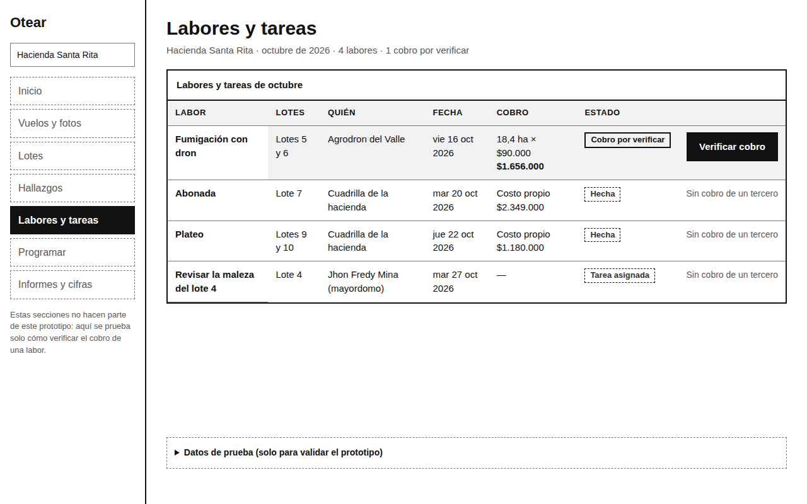<figcaption>Pantalla 10 · Labores y tareas</figcaption></figure>
<figure>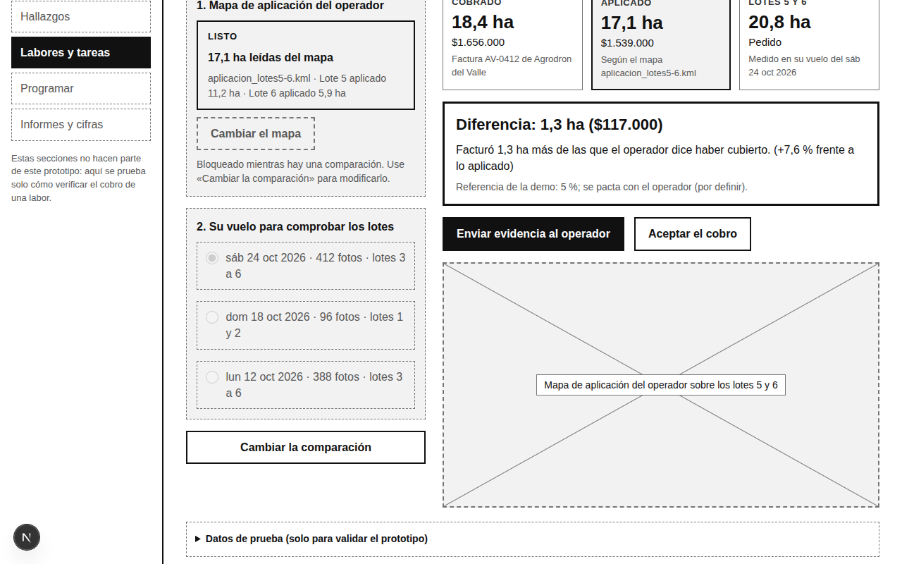<figcaption>Pantalla 11 · Verificar cobro, con el veredicto</figcaption></figure>
</div>
<div class="par">
<figure><figcaption>Pantalla 12 · Compartir evidencia</figcaption></figure>
<figure>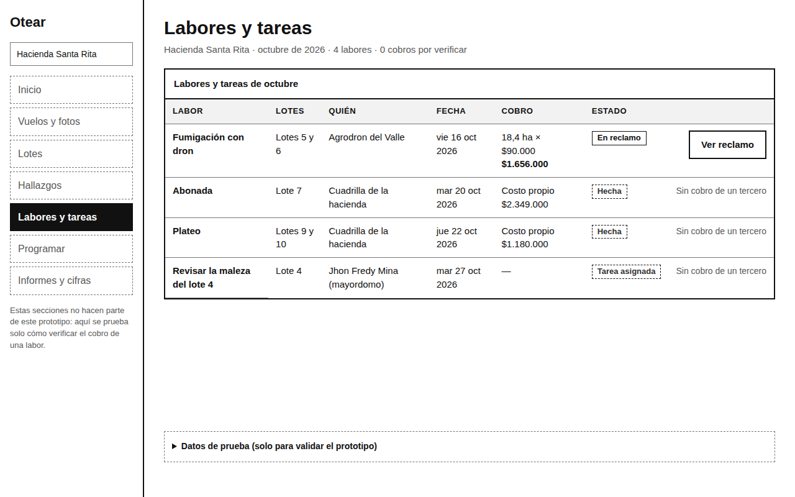<figcaption>Fin del flujo: la labor queda «En reclamo»</figcaption></figure>
</div>

## Iteración 2 · Corregir lo que encontró la revisión externa

**Cómo ocurrió.** Terminada la iteración 1, audité el resultado (sección 5, D1 a D5) y corregí en la conversación sin redactar un prompt aparte. Después mandé la entrega a una sesión de revisión independiente. Su informe encontró tres defectos que seguían en el sitio publicado y se los pasé a la herramienta tal cual. Escribo aquí esa corrección con las tres capas de lo que pedí y de lo que se cambió, para que se vea qué reglas de negocio hay detrás.

En el formato «Prompt ajuste», uno por caso (Tabla 9). «Regla» en los tres: nada puede desbordar ni quedar cortado, y no se toca nada más.

| Caso (pantalla · comportamiento · contenido) | Ajuste que se pidió |
|---|---|
| **C1 · Pantalla 11, factura en $0** (comportamiento) | Ajusta solo este caso sin cambiar el resto: con la factura en $0 no hay cobro que aceptar ni diferencia que reclamar. Aplica: «Enviar evidencia al operador» y «Aceptar el cobro» quedan deshabilitados, cada uno con su motivo escrito; el veredicto no imprime porcentaje. Si no pasa, no hay salida nueva: el estado explica por qué y «Volver a Labores y tareas» sigue activo. |
| **C2 · Pantalla 11, diálogo de aceptar** (pantalla) | Ajusta solo este caso sin cambiar el resto: el diálogo «¿Aceptar el cobro de $1.656.000?» sale pegado a la esquina. Aplica: centrado en la ventana, sin tocar la estructura de tres columnas. |
| **C3 · Pantalla 12, botón «Enviar»** (pantalla y contenido) | Ajusta solo este caso sin cambiar el resto: «Enviar» no se ve sin desplazarse a 1280 × 800. Aplica: los botones suben bajo la vista previa, que baja a 16:9. Contenido: «No hay diferencia que reclamar: la factura está en $0.»; con el mapa leído y sin comparar, la tarjeta «Aplicado» dice «Falta comparar»; los lotes de «Plateo» son 9 y 10. |

Table: Ajustes pedidos en la iteración 2

**Lo que generó:** los cambios D6 a D8 de la sección 5, con captura de antes (sitio publicado) y de después.

Las Figuras 6 y 7 comparan la pantalla antes y después del ajuste C1.

<div class="par">
<figure>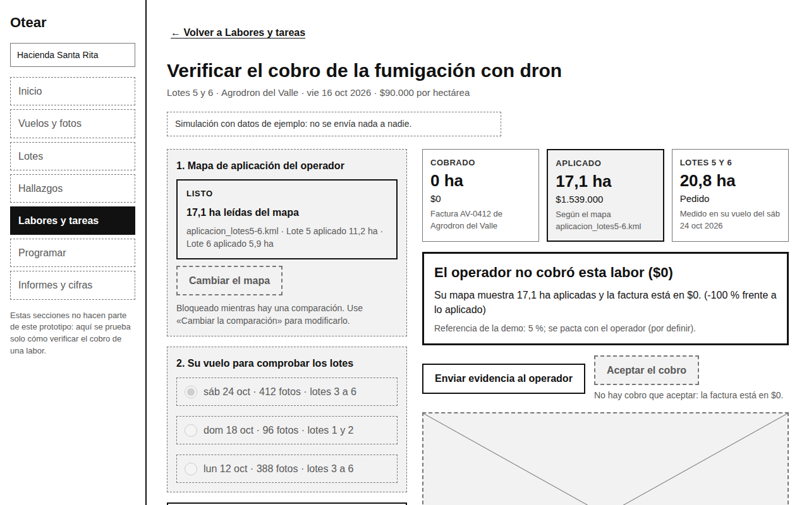<figcaption>Antes: factura en $0 y «Enviar» sigue activo</figcaption></figure>
<figure>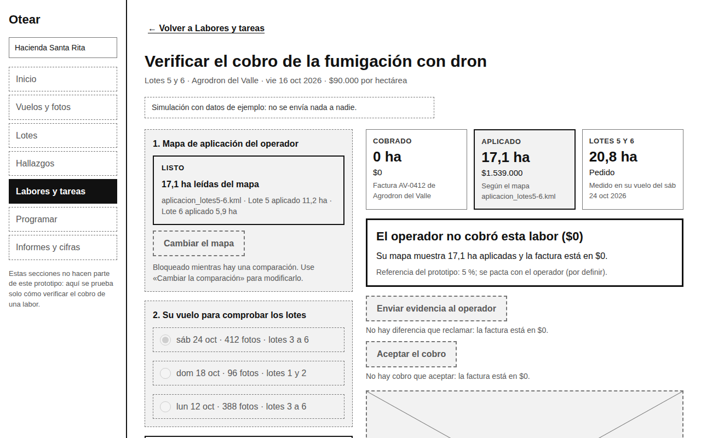<figcaption>Después: deshabilitado y con motivo</figcaption></figure>
</div>

# 5. Registro de auditoría

Audité lo que generó la herramienta en un navegador real, con un viewport de 1280 × 800, y no en el editor. Encontré ocho decisiones que corregí: D1 a D3 cambian la jerarquía, la acción primaria y lo irreversible; D4 y D5 son de contenido; D6 a D8 salieron de la revisión externa. Seis tienen captura de antes y después (D1, D2, D3, D6, D7 y D8); D4 y D5 no tienen captura del antes y lo explico en cada una.

## a) Decisiones de la IA que corregí

### D1 · «Comparar» quedaba fuera de pantalla

**Qué decidió la IA.** Apiló el mapa, el vuelo (tres opciones de dos líneas) y un aviso de dos líneas, y puso «Comparar» al final de esa columna.

**Por qué no sirve para Hernando.** H1 depende de que encuentre solo qué hacer. A 1280 × 800 el botón empezaba en y = 812, así que quedaba fuera, y como está deshabilitado hasta completar los dos pasos, nada le avisaba de que había uno más abajo.

**Corrección.** Opciones de vuelo en una línea, columna más ancha (de 340 a 380 px) y aviso en una línea. Ahora el botón queda entre 722 y 770 px. Con una ventana de navegador de menos de 800 px de alto igual hay que desplazarse un poco; lo dejo como límite.

Las Figuras 8 y 9 comparan el antes y el después de esta corrección.

<div class="par">
<figure>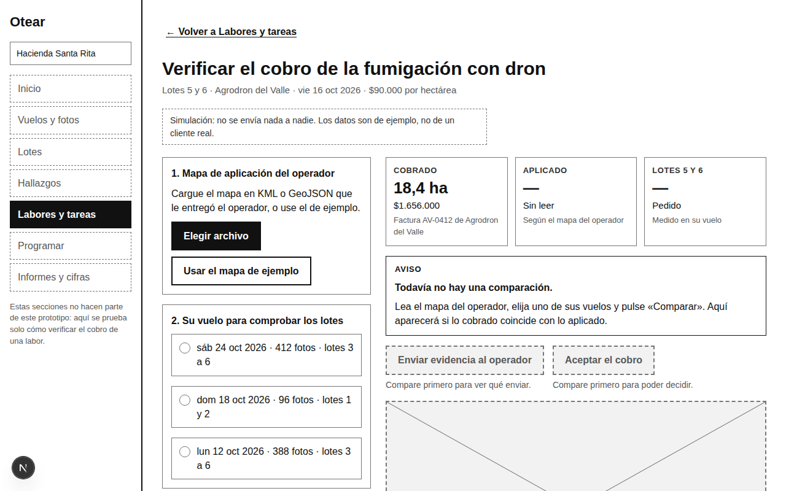<figcaption>Antes: «Comparar» no se ve</figcaption></figure>
<figure>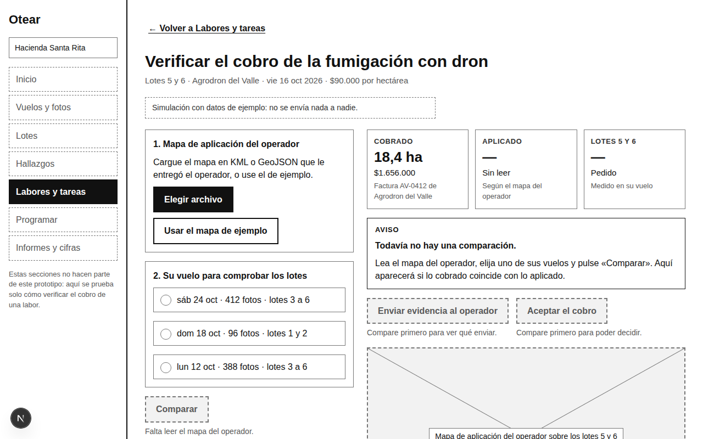<figcaption>Después: se ve, con su motivo</figcaption></figure>
</div>

### D2 · Una nota larga del operador escondía el veredicto

**Qué decidió la IA.** Mostró la nota completa encima del veredicto, porque la nota explica el cobro.

**Por qué no sirve para Hernando.** Lo que quiere saber primero es si le cobraron de más. Con una nota de 716 caracteres el veredicto bajó a y = 701 y los botones quedaron fuera de pantalla. La nota es el argumento de quien quiere cobrar, y no tiene que ir antes que la respuesta.

**Corrección.** El veredicto y las acciones van primero; la nota queda debajo, plegada, con su largo en el título. El veredicto queda en y = 416 con cualquier nota.

Las Figuras 10 y 11 comparan el antes y el después de esta corrección.

<div class="par">
<figure>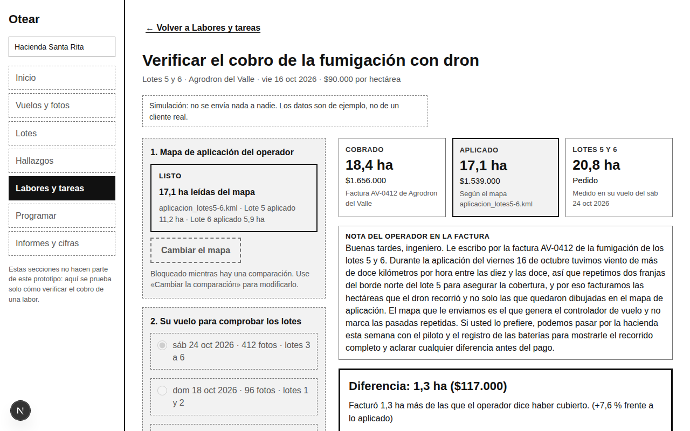<figcaption>Antes: el veredicto en el borde inferior</figcaption></figure>
<figure><figcaption>Después: veredicto y acciones primero</figcaption></figure>
</div>

### D3 · Un cobro de $0 se trataba como un cobro menor

**Qué decidió la IA.** Con la factura en $0 mostró «No se puede calcular la diferencia en pesos», «−100 %» y «Aceptar el cobro» como acción principal.

**Por qué no sirve para Hernando.** Aceptar no se puede deshacer, y se lo recomendaba sobre una factura que no cobra nada. Tampoco había diferencia que reclamar.

**Corrección.** Estado propio «El operador no cobró esta labor ($0)» y «Aceptar» deshabilitado con su motivo. Esta corrección quedó a medias: la revisión externa vio que «Enviar evidencia» seguía activo y abría un mensaje vacío. Lo resolví en D6.

Las Figuras 12 y 13 comparan el antes y el después de esta corrección.

<div class="par">
<figure>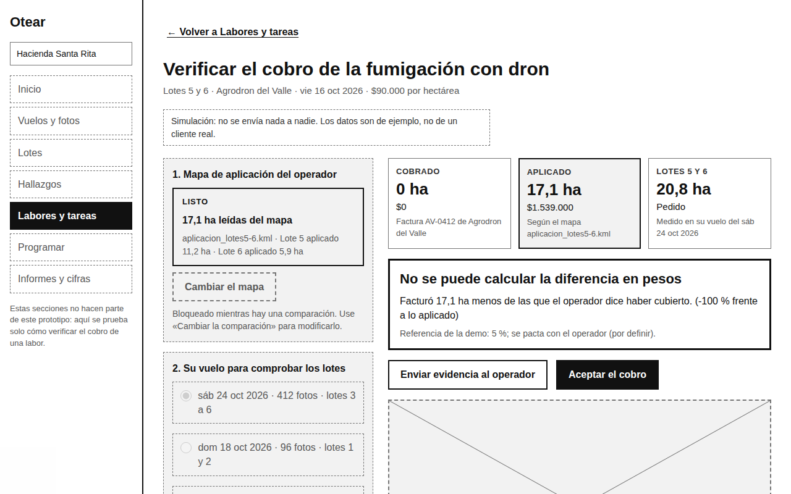<figcaption>Antes</figcaption></figure>
<figure><figcaption>Después (ver D6 para «Enviar»)</figcaption></figure>
</div>

### D4 · Una instrucción de prueba estaba dentro del flujo

**Qué decidió la IA.** Escribió bajo el campo del WhatsApp: «Para probar el error, use +57 300 000 0000».

**Por qué no sirve.** El flujo se valida con personas que deben completarlo sin instrucciones; esa frase les dice cómo provocar un error. La corrección: la instrucción vive solo en el panel plegado «Datos de prueba». No tengo captura del antes, porque lo corregí en la misma sesión en que apareció y no lo guardé; lo digo para no inventar una.

### D5 · Textos fijos que solo servían para una labor

**Qué decidió la IA.** Escribió «lotes 5 y 6» y las fechas de la fumigación dentro de los mensajes de error y de los soportes de la evidencia.

**Por qué no sirve.** Con cualquiera de las otras labores de la lista (hay un caso con 40) el error hablaría de lotes que no son suyos. **Corrección:** los textos se construyen con los lotes y las fechas de la labor abierta, y una prueba automática lo vigila (esa prueba encontró además un «no los 1» con un solo lote). Tampoco tengo captura del antes: lo vi en el código, no en pantalla.

### D6 · Con $0, «Enviar evidencia» seguía activo y abría un mensaje vacío

**Qué decidió la IA.** Al arreglar D3 deshabilitó «Aceptar» pero dejó «Enviar» habilitado, y el veredicto seguía imprimiendo «−100 %».

**Por qué no sirve.** Es el caso que invita a cargar el panel «Datos de prueba», y contradecía lo que yo había escrito en D3. Invitaba a reclamar una diferencia que no existe con un mensaje en blanco.

**Corrección.** «Enviar» deshabilitado con «No hay diferencia que reclamar: la factura está en $0.» y sin porcentaje en el veredicto.

Las Figuras 14 y 15 comparan el antes y el después de esta corrección.

<div class="par">
<figure>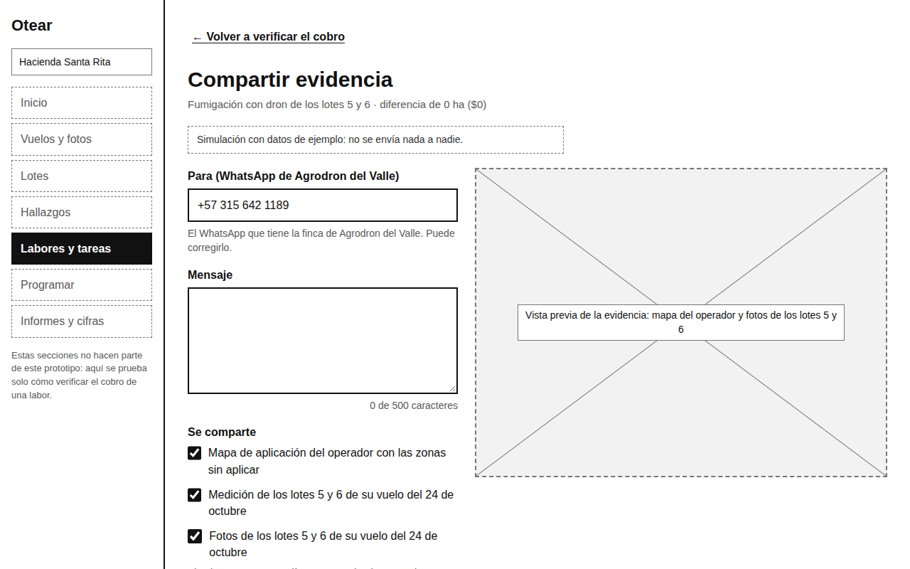<figcaption>Antes: «Enviar» abre «0 de 500 caracteres»</figcaption></figure>
<figure><figcaption>Después: ya no se puede abrir</figcaption></figure>
</div>

### D7 · El diálogo para aceptar el cobro salía pegado a la esquina

**Qué decidió la IA.** Dejó el diálogo en la esquina superior izquierda (x = 0, y = 0), encima del menú y del título. La causa era que el estilo base quitaba el margen automático del diálogo.

**Por qué no sirve.** Es el único momento irreversible del flujo, y la confirmación quedaba en un lugar donde Hernando no mira. **Corrección:** centrado (ahora x = 400, y = 294).

Las Figuras 16 y 17 comparan el antes y el después de esta corrección.

<div class="par">
<figure>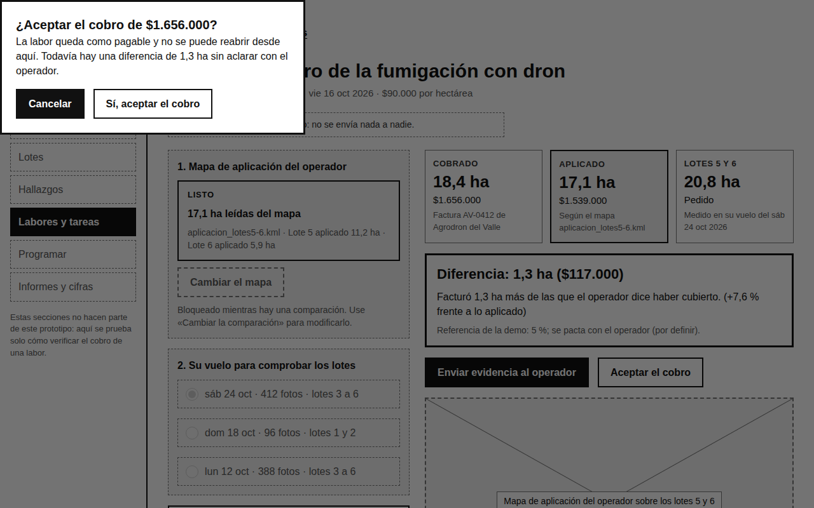<figcaption>Antes</figcaption></figure>
<figure>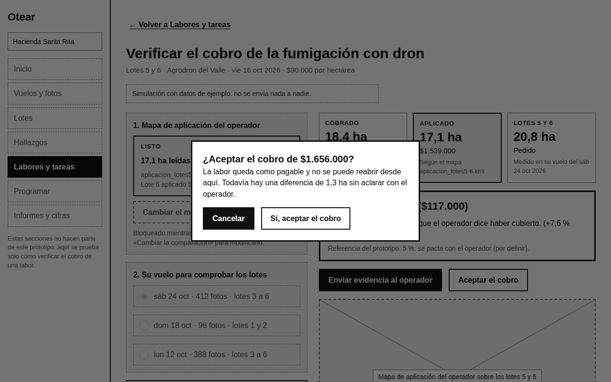<figcaption>Después</figcaption></figure>
</div>

### D8 · En «Compartir evidencia», «Enviar» quedaba fuera de pantalla

**Qué decidió la IA.** Puso la vista previa de 4:3 en la columna derecha y los botones al final de la columna izquierda, después del mensaje y de los tres soportes.

**Por qué no sirve.** Es el mismo defecto de D1 en otra pantalla: «Enviar» empezaba en y = 851 con un viewport de 800. **Corrección:** los botones pasan debajo de la vista previa, que baja a 16:9, y «Enviar» queda en y = 578.

Las Figuras 18 y 19 comparan el antes y el después de esta corrección.

<div class="par">
<figure>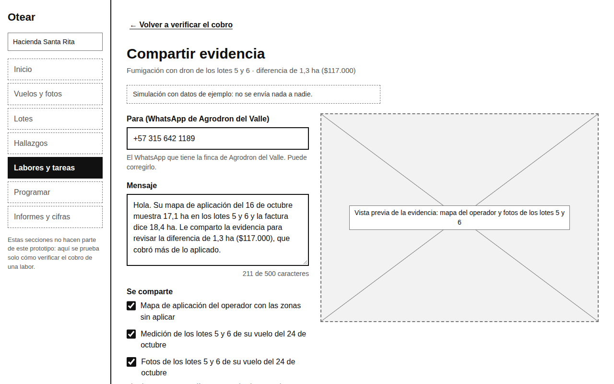<figcaption>Antes: «Enviar» no se ve</figcaption></figure>
<figure>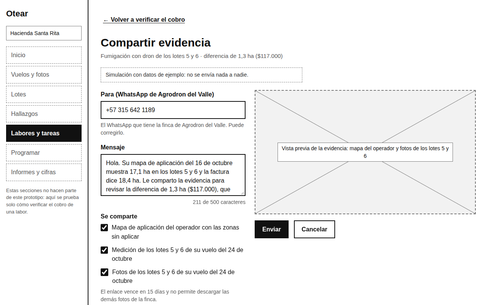<figcaption>Después: se ve sin desplazarse</figcaption></figure>
</div>

**Correcciones menores.** La primera columna de la tabla salía en mayúsculas; el cursor de los campos y los bordes sin color propio heredaban el azul del demo anterior (hoy ningún elemento tiene matiz); la tarjeta «Aplicado» decía «Sin leer» con el mapa ya leído; el aviso seguía pidiendo leer el mapa; «Ver reclamo» tenía un enlace que decía «Volver a verificar el cobro» pero llevaba a la lista; había una «Referencia de la demo» y un lote 16 en una hacienda de 12 lotes; el control «Datos de prueba» medía 32 px de alto (ahora 44).

## b) Datos extremos

Cargué cada caso desde el panel «Datos de prueba» y medí con estilos calculados: desborde horizontal, texto bajo 12 px, botones bajo 44 px, color con matiz y transiciones. Son siete conjuntos de datos (el normal y seis extremos) más archivos de mapa que preparé a mano. La Tabla 10 resume lo que se rompió y el ajuste.

| Caso | Qué se rompió | Ajuste |
|---|---|---|
| Nota del operador de 716 caracteres | El veredicto bajó a y = 701 y los botones salieron de la pantalla | Nota plegada bajo las acciones (D2) |
| Cobro de $0 | Veredicto sin pesos, «−100 %», «Aceptar» como principal y mensaje en blanco | Estado «sin cobro» con las dos acciones deshabilitadas y su motivo (D3 y D6) |
| 40 labores | La lista no se desbordó, pero los textos de error y de soportes eran de otra labor | Textos construidos por labor (D5) |
| Cobro de casi $50.000.000 | El diseño aguantó. Pero la pantalla muestra a la vez «$90.000 por hectárea» y una diferencia de $3.532.608 (a $2.717.391 por ha), y nada avisa que el precio se salió de lo normal | Sin ajuste: avisar un precio atípico necesita una tarifa de referencia que el producto no tiene y no quiero inventar. Queda como decisión pendiente |
| Mapa válido de otra superficie (123 ha, hallado por la revisión externa) | Se acepta como «123,4 ha leídas» y el veredicto dice que facturó 105 ha menos | Sin ajuste: hay que decidir si el mapa se recorta a los lotes de la labor. Pendiente |
| Campos vacíos (WhatsApp, mensaje, ningún soporte) | Nada: «Enviar» queda deshabilitado y dice qué falta | — |
| Archivos de mapa malos (`.txt`, `.shp`, KML vacío o roto, de otra finca) | Nada: dan tres mensajes distintos (formato no admitido, sin zonas, de otra finca) con tres partes cada uno y salida. El `.txt` y el `.shp` dan el mismo mensaje | — |
| Nombre de operador de 78 caracteres | Nada: se parte en varias líneas en la tabla, el subtítulo y la tarjeta | — |
| 0 labores | Nada: estado vacío que explica qué aparece ahí | — |

Table: Datos extremos probados y ajuste hecho

Las Figuras 20 y 21 muestran dos de los casos extremos.

<div class="par">
<figure>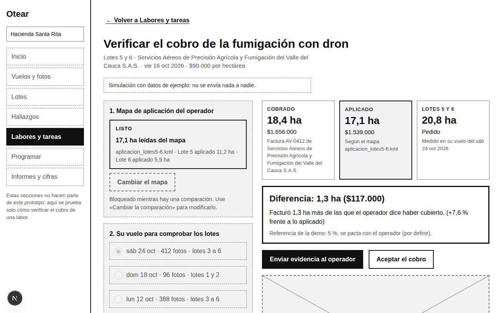<figcaption>Operador de 78 caracteres: se lee sin tapar nada</figcaption></figure>
<figure>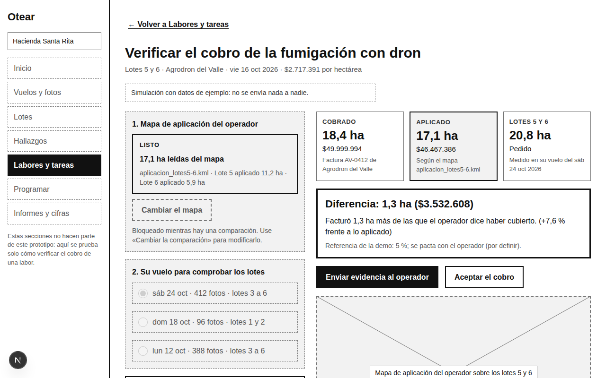<figcaption>Cobro de casi $50.000.000</figcaption></figure>
</div>

## c) Los cuatro estados de los cuatro elementos clave

Son recortes tomados en el navegador, en el sitio construido. Los elementos clave son los que cambian el rumbo de la tarea: cargar el mapa, comparar, enviar la evidencia y aceptar el cobro. Las Figuras 22 a 25 muestran sus estados.

<!--STATES-->

# 6. Enlace del prototipo

**https://otear.pages.dev/prototipo/verificar-cobro/**

Está publicado y es público. Para quien lo califica, un recorrido de un minuto (opcional): pulsar «Verificar cobro», usar el mapa de ejemplo, elegir el vuelo del 24 de octubre y pulsar «Comparar». Usar los botones «Volver» del prototipo: el botón Atrás del navegador sale de él. Para ver los errores, abrir «Datos de prueba» al final de la página: allí están el número que hace fallar el envío (+57 300 000 0000), el caso de $0 y los demás.

# Referencias

::: {.refs}
McCurdy, M., Connors, C., Pyrzak, G., Kanefsky, B., y Vera, A. (2006). Breaking the fidelity barrier: An examination of our current characterization of prototypes and an example of a mixed-fidelity success. En *CHI '06: Proceedings of the SIGCHI Conference on Human Factors in Computing Systems* (pp. 1233–1242). ACM.

MeasuringU. (s. f.). *10 things to know about completion rates*. https://measuringu.com/completion-rates/

Pernice, K. (s. f.). *UX prototypes: Low fidelity vs. high fidelity*. Nielsen Norman Group. https://www.nngroup.com/articles/ux-prototype-hi-lo-fidelity/

Rojas Correa, L. M. (2026, 25 de octubre). *Otear: plataforma web para centralizar la información aérea de fincas y obras* [Trabajo de curso]. Universidad Icesi.
:::
