

## Ficha del proyecto

**Producto.** Otear reúne en un solo lugar las fotos, los mapas y los vuelos de dron de una finca, para que quien contrata labores pueda comprobar lo que le cobran.

**Usuario.** Hernando, 56 años, administra la Hacienda Santa Rita (caña de azúcar, Valle del Cauca). Trabaja en el computador de la oficina y usa WhatsApp.

**Problema (PP3 del Brief de S1).** Paga por hectárea labores que no puede comprobar y queda mal frente a sus socios si algo sale mal. Es el punto de dolor de mayor carga emocional.

**Flujo de mayor riesgo que se prototipó.** Verificar el cobro de una fumigación con dron (tarea T2: «El operador le cobró 18,4 ha. Revise si las hizo y, si no, mándele la evidencia»). Se eligió porque:

1. No tiene un patrón conocido: no es subir un archivo ni leer un reporte, es decidir si pagar.
2. Termina en una acción irreversible (aceptar el cobro).
3. Depende de un supuesto de factibilidad sin probar: que el operador entregue un mapa legible (Tabla 3, fila 4).
4. Respalda el supuesto de valor n.º 2 de S1: quien contrata por hectárea quiere verificar y compartiría la evidencia.

**Lo que se entrega.** Un prototipo navegable de tres pantallas (Labores y tareas → Verificar cobro → Compartir evidencia) con sus errores y salidas, en escala de grises y sin animación; la skill que lo guió; el registro de lo que la IA decidió mal y se corrigió; y siete casos de datos extremos.

**Estado de la evidencia.** Lo que sigue se midió en un navegador a 1280 × 800: 4 estados × 4 elementos clave, 5 decisiones de la IA corregidas con captura antes y después, 7 casos de datos extremos y 16 pruebas automáticas de la lógica. **No hubo prueba con personas** en esta semana: las dos hipótesis se miden en la semana 4. Los datos son sintéticos y verosímiles (Hacienda Santa Rita, sus lotes y sus cifras vienen del Brief de S1), no de un cliente real.

# 1. Hipótesis a validar

*Resumen: el prototipo pone a prueba dos hipótesis del Brief de S1, una de comprensión (¿entiende lo que le cobran?) y una de decisión (¿reclama en vez de pagar?).*

**H1 · Comprensión** (Tabla 3, fila 3 de usabilidad, y OD1)

> Creo que **Hernando** logrará **decir, sin ayuda, si el cobro de la fumigación coincide con lo aplicado** en la **pantalla 11 «Verificar cobro»** porque ve lado a lado lo cobrado, lo aplicado según el mapa del operador y los lotes medidos en su propio vuelo, con la diferencia en hectáreas y en pesos antes de cualquier botón. **Lo sabré si** al menos **4 de 5** participantes dicen sin ayuda que el operador cobró **1,3 ha ($117.000) de más**, en **menos de 2 minutos** desde que abren «Labores y tareas», y si el promedio de su respuesta a «¿qué tanta seguridad tiene de saber lo que paga?» es de **4,5 o más sobre 5**.

**H2 · Decisión y valor** (Tabla 3, fila 2 de valor, y PP3)

> Creo que **Hernando** logrará **reclamar con evidencia en vez de aceptar el cobro** en las **pantallas 11 y 12** porque, cuando la diferencia supera la tolerancia, el botón principal pasa a ser «Enviar evidencia al operador» y el mensaje sale escrito con las cifras de la comparación. **Lo sabré si** al menos **4 de 5** participantes envían la evidencia sin pulsar «Aceptar el cobro» y sin quitar los tres soportes, y si al menos **3 de 5** cuentan en la entrevista que han tenido una diferencia de cobro en el último año y que le mandarían esa evidencia a su operador real.

**Cómo se medirá (semana 4).** Prueba moderada con 5 personas del perfil, con la tarea T2 y pensando en voz alta; éxito, tiempo y la pregunta de confianza se registran en Maze. Una persona «sin ayuda» es la que no recibe ninguna pista del moderador.

**Cómo leer los resultados.** Con 5 personas la prueba es **formativa**: sirve para encontrar y corregir problemas, no para estimar una tasa. Con el método de Wald ajustado, 4 de 5 equivale a un intervalo de confianza del 95 % de **36 % a 98 %**, y 5 de 5 a 51 % a 100 % (MeasuringU, 2026). Por eso «4 de 5» es una **regla de decisión** (si menos, se rediseña), no una cifra de éxito. El umbral de 2 minutos es un punto de partida mío: S1 no fijó un tiempo para esta tarea (los 3 minutos del objetivo OB2 son para subir un vuelo), y la espera simulada del prototipo (0,9 s por paso) se descontará del tiempo medido.

**Límite que se declara.** En el prototipo el botón principal ya cambia según el veredicto. Que alguien lo pulse prueba que la guía funciona, no que haría el reclamo en su finca: por eso H2 exige además lo que la persona cuente en la entrevista.

# 2. Matriz de fidelidad

*Resumen: fidelidad visual baja, un solo flujo muy profundo, interactividad media-alta y datos con forma real. Cada nivel se eligió por lo que la prueba de la semana 4 necesita saber, y cada fila dice qué no se podrá concluir.*

Las cinco dimensiones son independientes (McCurdy et al., 2006): un prototipo puede ser bajo en una y alto en otra. Este es de fidelidad **mixta**.

| Dimensión | Nivel elegido y detalle | Justificación principal |
|---|---|---|
| **Refinamiento visual** | **Bajo.** Escala de grises (todos los colores con R = G = B, medido por estilo calculado), sin marca ni logotipo, tipografía Arial, bordes en vez de sombras, mapas y fotos como marcadores con una X y su proporción real (16:9 y 4:3). Los estados se distinguen por forma (borde sólido, doble o discontinuo) y por texto, no por color. | Lo que H1 pone a prueba es si Hernando **entiende el veredicto por lo que dice**. Sin rojo y verde, el «Facturó de más» no puede entenderse por un semáforo: si lo entiende, es por el texto y los números. Además la marca y el color aún no están decididos, y cambiar un texto en grises cuesta minutos. **No se podrá concluir:** si el diseño final inspira la confianza que pide OD1; esa parte se mide en una versión de alta fidelidad. |
| **Amplitud** | **Un flujo** de los tres de S1: verificar el cobro (pantallas 10, 11 y 12 más el estado «En reclamo»). Las otras seis secciones del menú aparecen deshabilitadas. | Es el flujo con mayor riesgo (PP3, supuesto de valor n.º 2) y sin patrón conocido. «Subir un vuelo» tiene un patrón de carga de archivos ya conocido y depende de una política de fotos sin GPS que sigue sin resolverse; «Del hallazgo a la tarea» depende de una IA que aún no se valida. Ampliar costaría días y no respondería a H1 ni a H2. **No se podrá concluir:** cómo se siente moverse entre secciones. |
| **Profundidad** | **Alta en ese flujo.** Camino completo con tres salidas (enviar evidencia, aceptar, pedir el mapa al operador), cinco errores con su salida (mapa en formato no admitido, vacío, ilegible, de otra finca y vuelo no válido) y una confirmación para el paso irreversible. | H2 solo se puede probar si existe el momento real de decidir entre aceptar y reclamar, y la Tabla 3, fila 4 (el operador entrega un mapa legible) solo se prueba si el mapa puede fallar. Un flujo hasta la mitad habría dejado fuera justo lo que se quiere observar. **No se podrá concluir:** qué pasa después de enviar la evidencia (la respuesta del operador). |
| **Interactividad** | **Media-alta.** Responden los elementos de la tarea: cargar un archivo o usar el de ejemplo, elegir vuelo, comparar, editar el mensaje, marcar soportes, confirmar. Cada uno tiene Normal, Cargando, Error y Deshabilitado, resueltos en la misma pantalla. Transiciones instantáneas, con una espera simulada de 0,9 s en cada paso para poder observar «Cargando». | Medir tiempo y éxito en Maze exige que el sistema responda como uno real; con imágenes estáticas el participante tendría que adivinar. Se evita la animación porque en la semana 2 se valida la navegación, no el movimiento. **No se podrá concluir:** si el movimiento ayudaría a entender el cambio de estado. |
| **Modelo de datos** | **Alto en forma, sintético en origen.** Las cifras de S1 cuadran entre pantallas (18,4 ha cobradas, 17,1 ha aplicadas, 20,8 ha medidas, 1,3 ha = $117.000 a $90.000 por ha). El mapa del operador es un KML que se lee de verdad en el navegador, y la comparación usa la misma lógica con pruebas de la demo. Hay siete casos extremos cargables. | Los participantes deben reaccionar a dinero y hectáreas creíbles; con «$XX.XXX» no habría reacción que medir. Un archivo real que puede fallar prueba la factibilidad de leer mapas de operadores. El origen es sintético: la validación con datos de una finca real (tres vuelos y tres operadores, Tabla 3, filas 4 y 5) queda para la semana 4. **No se podrá concluir:** que la aritmética sirva con los formatos de mapas que traigan operadores reales. |

# 3. Skill del proyecto y herramienta

**Herramienta elegida: código (Next.js) con Claude Code.** No se usó Lovable ni Figma Make. El riesgo de este flujo está en una cuenta (hectáreas cobradas contra aplicadas), en leer un archivo KML real y en estados con tiempos de espera; eso exige lógica verdadera y pruebas, que un generador de pantallas no da. Las decisiones de alcance, flujo y criterios son del autor; la herramienta escribió el código y se auditó su resultado (sección 5).

**Carga de la skill.** El archivo está en `.claude/skills/otear-prototipo-s2/SKILL.md` y Claude Code lo ofrece como skill del proyecto. Tiene los siete bloques de la consigna (producto y usuario, hipótesis y riesgos, flujos y arquitectura, reglas de la etapa, reglas de contenido, reglas de comportamiento, prohibiciones). Cada regla indica el hallazgo de S1 que la respalda y cómo se comprueba en el navegador. El anexo A la reproduce completa.

PENDIENTE (lo hace el autor): captura de la skill cargada en Claude Code. Abrir una sesión nueva en el repositorio, escribir <code>/</code> y capturar la lista donde aparece <b>otear-prototipo-s2</b>. Guardarla como <code>capturas/skill-cargada.png</code> y agregarla aquí.

# 4. Prompt log

*Resumen: dos iteraciones. La primera construyó el flujo; la segunda corrigió lo que encontró la auditoría.*

PENDIENTE (lo hace el autor): pasar los prompts a la «plantilla B» de la consigna. Abajo están las tres capas (pantalla, comportamiento, contenido) tal como se enviaron o se enviarán.

## Iteración 1 · Construir el flujo completo

**Prompt enviado** (después de analizar la consigna y elegir el flujo): «Flujo B, empieza con la skill y la ruta del prototipo». Es corto porque el contexto ya estaba en la skill y en el Brief; las capas que heredó son:

| Capa | Lo que pedía |
|---|---|
| **Pantalla** | 10 Labores y tareas → 11 Verificar cobro → 12 Compartir evidencia en la ruta `/prototipo/verificar-cobro/`, 1280 × 800, grises, sin marca. |
| **Comportamiento** | Leer el mapa del operador (cargando, error, listo); comparar contra un vuelo propio posterior a la labor; veredicto con la tolerancia de 5 %; enviar evidencia o aceptar con confirmación; errores con salida. |
| **Contenido** | Hacienda Santa Rita, Agrodron del Valle, 18,4 ha cobradas, 17,1 ha en su mapa, 20,8 ha de los lotes 5 y 6, diferencia de 1,3 ha = $117.000 a $90.000 por ha. |

**Lo que generó la herramienta:** la ruta, la lógica con sus pruebas y las tres pantallas.

<figure><figcaption>10 · Labores y tareas</figcaption></figure>
<figure><figcaption>11 · Verificar cobro, con el veredicto</figcaption></figure>

<figure><figcaption>12 · Compartir evidencia</figcaption></figure>
<figure><figcaption>Fin del flujo: la labor queda «En reclamo»</figcaption></figure>

## Iteración 2 · Corregir lo que encontró la auditoría

**Prompt.** Pide un cambio junto con lo que no se debe tocar, una pantalla a la vez:

| Capa | Lo que pide |
|---|---|
| **Pantalla** | En «Verificar cobro» a 1280 × 800, «Comparar» debe verse completo sin desplazarse y el veredicto debe verse en la primera pantalla con cualquier nota del operador. No cambiar la estructura de las tres columnas. |
| **Comportamiento** | Si la factura está en $0 no hay cobro que aceptar ni diferencia que reclamar: ambas acciones deshabilitadas con el motivo escrito al lado. La instrucción para provocar el error del WhatsApp no debe aparecer en el flujo. |
| **Contenido** | Los textos de error y de soportes se construyen con los lotes y las fechas de la labor abierta, no con los de la fumigación de ejemplo. |

**Lo que generó:** los cambios D1 a D5 de la sección 5, con captura antes y después.

PENDIENTE (honestidad del registro): los cambios D1 a D5 ya se hicieron en la conversación, al ver las capturas, antes de redactar este prompt como texto aparte. Si la entrega exige un prompt separado con su captura, hay que emitirlo de nuevo y guardar la respuesta; no se reescribe como si hubiera ocurrido antes.

# 5. Registro de auditoría

*Resumen: cinco decisiones de la IA se corrigieron por argumentos de usuario (acción primaria, jerarquía, irreversibilidad, contenido), y se probaron siete casos extremos de los que cuatro rompieron algo.*

## a) Decisiones de la IA que se corrigieron

**D1 · La acción que sigue quedaba fuera de pantalla (acción primaria).**
**Qué decidió la IA:** apiló el mapa, el vuelo (tres opciones de dos líneas) y un aviso de dos líneas, y puso «Comparar» al final. **Por qué es inadecuado:** la hipótesis H1 depende de que Hernando encuentre solo qué hacer; a 1280 × 800 el botón empezaba en y = 812 (viewport de 800) y, como estaba deshabilitado, nada le avisaba que había un paso más abajo. **Corrección:** opciones de vuelo en una línea, columna más ancha (340 a 380 px) y aviso en una línea; el botón queda entre 722 y 770 px.

<figure><figcaption>Antes: «Comparar» no se ve</figcaption></figure>
<figure><figcaption>Después: se ve, con su motivo</figcaption></figure>

**D2 · Una nota larga del operador escondía el veredicto (jerarquía de información).**
**Qué decidió la IA:** mostró la nota completa encima del veredicto porque «explica el cobro». **Por qué es inadecuado:** la pregunta de Hernando es si le cobraron lo que hicieron (PP3, OD1); con una nota de 716 caracteres el veredicto bajó a y = 701 y las acciones quedaron fuera de pantalla: la respuesta quedaba detrás del texto de quien más interés tiene en que se pague. **Corrección:** veredicto y acciones primero; la nota va debajo, plegada y con su longitud. El veredicto queda en y = 416 con cualquier nota.

<figure><figcaption>Antes: el veredicto en el borde inferior</figcaption></figure>
<figure><figcaption>Después: veredicto y acciones primero</figcaption></figure>

**D3 · Un cobro de $0 llevaba a «Aceptar» y a un mensaje vacío (qué es irreversible).**
**Qué decidió la IA:** lo trató como un cobro menor: «No se puede calcular la diferencia en pesos», «−100 %», «Aceptar el cobro» como acción principal, y «Enviar evidencia» abría un mensaje en blanco. **Por qué es inadecuado:** aceptar es irreversible y se recomendaba sobre una factura que no cobra nada, y se invitaba a reclamar una diferencia que no existe. **Corrección:** estado propio «El operador no cobró esta labor ($0)», sin acción primaria y con las dos acciones deshabilitadas diciendo por qué.

<figure><figcaption>Antes</figcaption></figure>
<figure><figcaption>Después</figcaption></figure>

**D4 · Una instrucción de prueba estaba dentro del flujo del usuario (contenido).**
**Qué decidió la IA:** escribió bajo el campo del WhatsApp «Para probar el error, use +57 300 000 0000». **Por qué es inadecuado:** el flujo se valida con personas que deben completarlo sin instrucciones; esa frase les dice cómo provocar un error. **Corrección:** la instrucción vive solo en el panel plegado «Datos de prueba».

**D5 · Textos fijos que solo servían para una labor (contenido real y coherente).**
**Qué decidió la IA:** escribió «lotes 5 y 6» y las fechas de la fumigación dentro de los mensajes de error y de los soportes. **Por qué es inadecuado:** con cualquier otra labor contratada (la lista de 40 las genera) el error hablaría de lotes que no son suyos. **Corrección:** los textos se construyen con los lotes y las fechas de la labor abierta; una prueba automática lo vigila y encontró además un fallo de redacción con un solo lote («no los 1»).

*Correcciones menores (no cuentan como de fondo):* la primera columna de la tabla salía en mayúsculas y sin el fondo de la fila marcada; el cursor de los campos y los bordes sin color propio heredaban el azul del demo, y hoy 0 elementos tienen matiz.

## b) Stress test con datos extremos

Los casos se cargan desde el panel «Datos de prueba» del prototipo. Cada uno se midió con estilos calculados (desborde horizontal, texto bajo 12 px, botones bajo 44 px, color con matiz, transiciones).

| Caso | Qué se rompió | Ajuste |
|---|---|---|
| Nota del operador de 716 caracteres | El veredicto bajó a y = 701 y las acciones quedaron fuera de pantalla | Nota plegada bajo las acciones (D2) |
| Cobro de $0 | Veredicto sin pesos, «−100 %», «Aceptar» como principal, mensaje en blanco | Estado «sin cobro» con acciones deshabilitadas y motivo (D3) |
| 40 labores | La lista no se desbordó, pero los textos fijos de error y soportes eran de otra labor | Textos construidos por labor (D5) |
| Campos vacíos (WhatsApp, mensaje, soportes) | Nada; «Enviar» queda deshabilitado y dice qué falta, de a uno | — |
| Mapa vacío, roto, `.shp`, `.txt` o de otra finca | Nada; cada uno da su error con tres partes (qué pasó, por qué, qué hacer) y «Pedir el mapa al operador» | — |
| Nombre de operador de 77 caracteres | **Nada se rompió:** se parte en varias líneas en la tabla, el subtítulo y la tarjeta. La regla de corte de palabras ya estaba desde el primer borrador, así que este caso no la puso a prueba por sí solo | — |
| Cobro de $50.000.000 | **El diseño no se rompió** y la diferencia en pesos sale bien ($3.532.608). Queda una duda de producto sin resolver: nada avisa que el precio por hectárea es muy distinto al pactado | Sin cambio; es una decisión pendiente (no se inventan tarifas de mercado) |
| 0 labores | **Nada se rompió:** estado vacío que explica qué aparece ahí | — |

<figure><figcaption>Operador de 77 caracteres: se lee sin tapar nada</figcaption></figure>
<figure>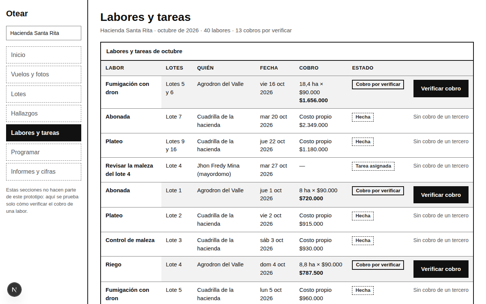<figcaption>40 labores</figcaption></figure>

## c) Los cuatro estados de cada elemento clave, verificados en el navegador

Recortes de pantalla tomados en el navegador a 1280 × 800 (no en el editor). Cada fila es un elemento; cada columna, un estado, y todo se resuelve en la misma pantalla.

<table class="estados">
<thead><tr><th>Elemento</th><th>Normal</th><th>Cargando</th><th>Error</th><th>Deshabilitado</th></tr></thead>
<tbody>
<tr><th>Cargar el mapa del operador</th><td>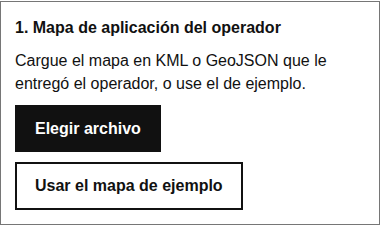</td><td>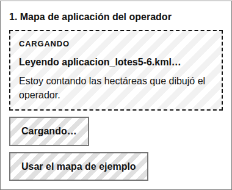</td><td>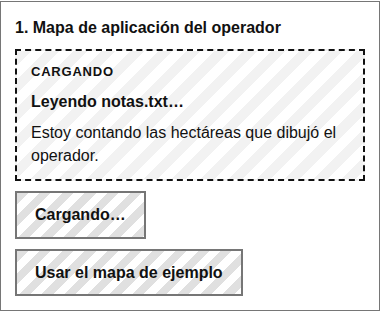</td><td>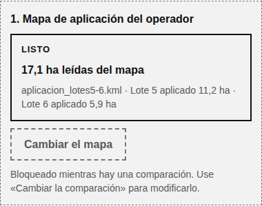</td></tr>
<tr><th>Comparar</th><td></td><td>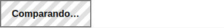</td><td>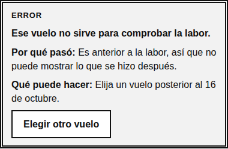</td><td>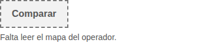</td></tr>
<tr><th>Enviar evidencia</th><td></td><td></td><td>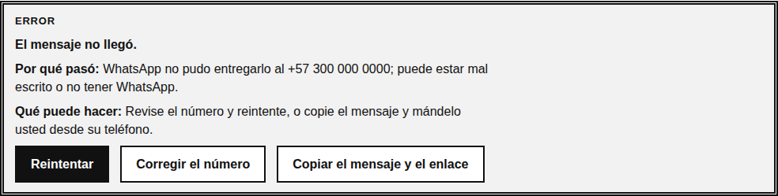</td><td>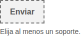</td></tr>
<tr><th>Aceptar el cobro</th><td>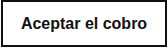</td><td></td><td>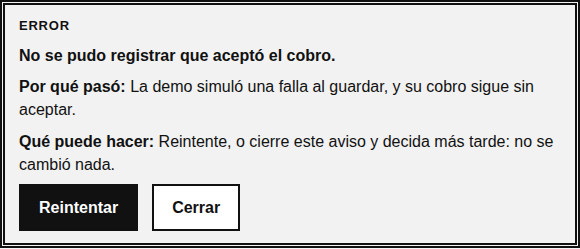</td><td>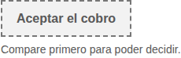</td></tr>
</tbody>
</table>

**Qué no se verificó.** Un recorrido completo solo con teclado y con lector de pantalla (sí el foco del diálogo: arranca en «Cancelar» y Escape lo cierra), y ninguna prueba con personas.

# 6. Enlace del prototipo

PENDIENTE: publicar y poner aquí el enlace público. Ruta prevista: <code>https://otear.pages.dev/prototipo/verificar-cobro/</code> (requiere publicar la rama; no se hace sin orden del autor). Abrirlo desde una ventana de incógnito para comprobar que es público.

**Cómo recorrerlo sin instrucciones.** Entrar, pulsar «Verificar cobro», usar el mapa de ejemplo, elegir el vuelo del 24 de octubre y pulsar «Comparar». Para ver los errores: cargar un archivo `.txt`, elegir el vuelo del 12 de octubre, o enviar la evidencia al número +57 300 000 0000. Todo esto también está en el panel plegado «Datos de prueba» al final de la página.

# Referencias

- McCurdy, M., Connors, C., Pyrzak, G., Kanefsky, B. y Vera, A. (2006). *Breaking the fidelity barrier: An examination of our current characterization of prototypes and an example of a mixed-fidelity success.* CHI 2006, 1233–1242.
- Nielsen Norman Group. *UX prototypes: Low fidelity vs. high fidelity.* https://www.nngroup.com/articles/ux-prototype-hi-lo-fidelity/
- TPX Impact. *Fidelity in prototyping.* https://www.tpximpact.com/knowledge-hub/blogs/design/fidelity-in-prototyping/
- Strategyzer. *Validate your ideas with the Test Card.* https://www.strategyzer.com/library/validate-your-ideas-with-the-test-card
- MeasuringU. *10 things to know about completion rates.* https://measuringu.com/completion-rates/
- Lovable. *Prompting.* https://docs.lovable.dev/prompting/prompting-one · Figma. *Write prompts for Figma Make.* https://help.figma.com/hc/articles/40097793879191
- Brief y Matriz de Supuestos de la Semana 1 (Otear, prototipo de baja fidelidad, 25 oct 2026).
